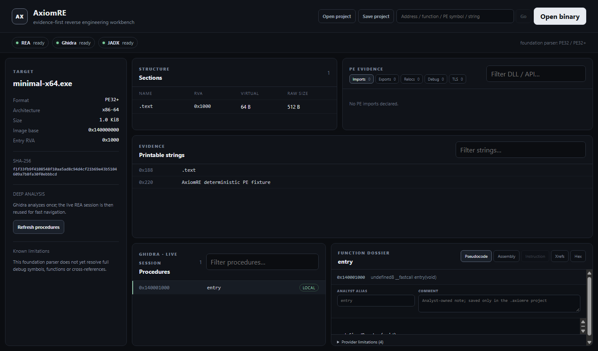

# AxiomRE

> **Pre-alpha / local development.** The project is not ready for public promotion yet.

AxiomRE is an open-source reverse-engineering workbench designed around three ideas:

1. **Evidence first.** Conclusions should link back to bytes, instructions, references, symbols, strings, control flow, or provider evidence.
2. **Modular engines.** Do not rebuild mature decompilers for vanity. Integrate strong open tooling where that is the reasonable engineering choice, while keeping our own data model and workflows vendor-independent.
3. **Human + automation.** Automation and AI should accelerate investigation, not hide uncertainty.



The screenshot above is generated from the project-owned deterministic PE fixture through the real desktop shell and live REA/Ghidra path; it is not a mockup.

## Current vertical slice

The current vertical slice is intentionally narrow but real:

- open a Windows PE file (`.exe` / `.dll`);
- parse core PE metadata ourselves, with bounded reads;
- list sections, parse named/ordinal imports with IAT RVAs, parse named/ordinal-only/forwarded exports, parse bounded PE base relocations, inspect Debug Directory / CodeView PDB identity, parse TLS Directory and callback addresses, extract bounded printable strings and calculate SHA-256;
- start one persistent REA/Ghidra MCP session per target;
- inventory local/external procedures after Ghidra analysis;
- select a local procedure and inspect normalized pseudocode + assembly;
- navigate resolved callers/callees and typed incoming/outgoing xrefs without exposing provider-specific JSON to the UI;
- inspect an exact address as decoded instruction, data, non-boundary, undecodable or outside-memory evidence;
- compare original file bytes with Ghidra's loaded-memory bytes in a bounded hex evidence view, marking bytes covered by known PE base relocations so loader fixups are not mistaken for unexplained mutation;
- jump by canonical address, function name, imported API/DLL or foundation string using the already-open analysis session, and navigate directly from PE entry-point/TLS-callback evidence after deep analysis;
- save/open a minimal `.axiomre` project that verifies the target SHA-256 before reuse;
- persist analyst-owned aliases/comments per function without modifying Ghidra or the executable;
- regenerate and test a project-owned deterministic PE32+ x64 fixture for legal regression coverage;
- detect local REA / Ghidra / JADX availability in the desktop workbench.

This proves the primary native-analysis path before we broaden into richer xrefs, graphs, plugins, debugging or additional formats.

## Technology

- Electron + React + TypeScript for the desktop shell;
- `@axiomre/core` for analysis-domain code that we own;
- Ghidra as an optional deep native-analysis provider;
- REA 6.7.0 pinned as an application dependency and wrapped behind `@axiomre/provider-rea`;
- JADX for Android analysis;
- a small plugin SDK whose contracts are versioned separately from the UI.

Heavy analysis belongs out of the renderer process.

## Development

```powershell
npm install
npm run check
npm run dev
```

### Reproducible demo

```powershell
npm run demo          # open the project-owned PE fixture with the owned parser
npm run demo:deep     # fixture + live persistent REA/Ghidra analysis
npm run demo:capture  # deep demo, capture the stable renderer, then exit
```

`demo:capture` writes `docs/assets/axiomre-v0.1-demo.png` only after deep analysis has completed and the recovered `entry` procedure is visible. The fixture is generated entirely from project-owned code. Deep demo/capture requires a compatible JDK and Ghidra; these tools are detected rather than silently downloaded.

For a dependency-clean verification equivalent to the CI entry path, run `npm run verify:checkout`. `npm install`/`npm ci` bring the supported REA version. Native Ghidra analysis additionally requires a compatible JDK and `GHIDRA_INSTALL_DIR`; the desktop reports whether those external tools are available instead of silently downloading them.

### Release verification (Windows)

```powershell
npm run release:verify  # check + license audit + unpacked package + packaged deep smoke
npm run package:win     # create the portable Windows artifact after verification
```

The packaged smoke launches the actual built `AxiomRE.exe`, opens the deterministic fixture, completes live REA/Ghidra analysis and requires a final renderer capture before passing. Ghidra/JADX remain external tools and are not redistributed. See `docs/DISTRIBUTION.md` for the package/license policy.

See `CONTRIBUTING.md` before contributing and `SECURITY.md` for the untrusted-input model and vulnerability-reporting rules.

## Project principles

- Prefer a clear 90–95% solution over a fragile 100% solution.
- Do not add complexity for marginal benchmark wins.
- Keep provider-specific details behind adapters.
- Every meaningful analysis claim should be representable with evidence and confidence.
- Keep the application useful without cloud AI.
- Do not copy proprietary implementation code. Proprietary tools may be studied behaviorally/clean-room where lawful; open-source tools are studied under their licenses.

See `docs/ARCHITECTURE.md`, `docs/DEVELOPMENT_STATE.md`, `docs/ROADMAP.md`, `docs/DECISIONS.md`, `docs/DEPENDENCY_LICENSES.md`, and `docs/BRANDING_REVIEW.md`.
